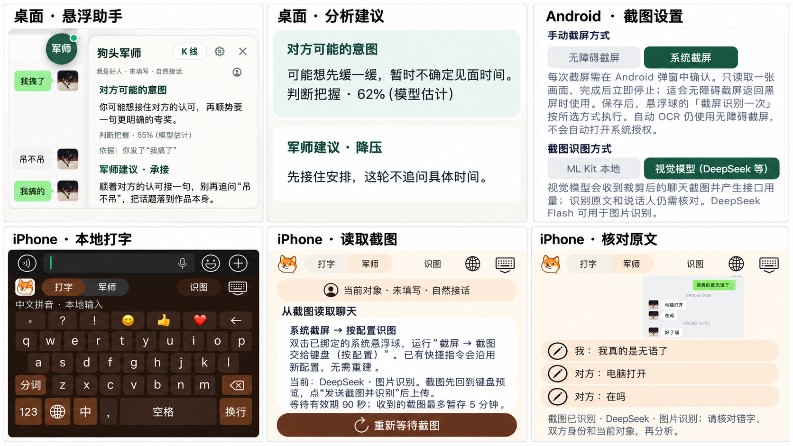

<!-- README_SYNC: source=714af1db8a9814841c9aec26534a6aa2592829cc; updated=2026-10-18 -->

<p align="center"><a href="./README.md">简体中文</a> · English</p>

<h1 align="center">Goutou Junshi Jev Chat</h1>

<p align="center"><strong>Understand a conversation, decide what to do next, and draft a reply that sounds like you.</strong></p>

<p align="center">A chat assistant built from <a href="https://github.com/shengjidaguai-china/goutoujunshi">Goutou Junshi</a>. It reads visible conversations or screenshots, lets you review the text, then suggests a strategy and reply drafts. Available as desktop overlays, an Android floating assistant, and an iOS keyboard. You choose when to send.</p>

<p align="center">If it helps, <a href="https://github.com/shengjidaguai-china/goutoujunshi-jev-chat/stargazers">give the project a Star</a> to find it again and help others discover it.</p>

<p align="center">
  <a href="https://github.com/shengjidaguai-china/goutoujunshi-jev-chat/stargazers"></a>
  <a href="https://github.com/shengjidaguai-china/goutoujunshi-jev-chat/releases"></a>
  <a href="https://github.com/shengjidaguai-china/goutoujunshi-jev-chat/actions/workflows/validate.yml"></a>
  <a href="LICENSE"></a>
</p>

## What it does

- **Clarifies the conversation:** separates known facts, possible intent, and unknowns, with next steps and conditions for stopping.
- **Helps you choose a reply:** explains each candidate's rationale and tradeoffs. Use “More like me” to adjust the wording.
- **Uses relationship context:** takes the current contact, relationship stage, and communication goal into account.
- **Visualizes chat activity:** import a chat CSV or explore five sample candlestick charts. The charts track message direction over time, not relationship quality or affection.

<a href="documentation/screenshots/product-overview-six.png"></a>

*AI-arranged screenshot collage; click to enlarge. Refer to the originals for exact UI details. The desktop analysis panel is an offline demo; confidence is a model estimate.*

<details>
<summary>Original screenshots and configuration guides (8 images)</summary>

- **Desktop**：[Floating assistant](documentation/screenshots/overlay-in-wechat.png) · [Analysis and advice](documentation/screenshots/analysis-detail-demo.png)
- **iPhone**：[Local typing](documentation/screenshots/ios-typing.jpg) · [Screenshot capture](documentation/screenshots/ios-capture.jpg) · [Transcript review](documentation/screenshots/ios-review.jpg)
- **Configuration**：[Mac provider settings](documentation/design/provider-config-preview.png) · [Android model settings](documentation/guides/android-deepseek/images/02-DeepSeek判断与回复.png) · [Android capture settings](documentation/guides/android-deepseek/images/04-识图开关与截屏方式.png)

Configuration screenshots reflect their respective versions. The Mac provider image predates OpenRouter support; consult the guides for current options.

</details>

## Choose your platform

All platforms are previews. Compatibility still needs validation on individual devices and chat app versions.

| Platform | Get started | Support and limitations |
| --- | --- | --- |
| **macOS** | [Source preview ZIP](https://github.com/shengjidaguai-china/goutoujunshi-jev-chat/releases/latest/download/goutoujunshi-jev-chat-mac.zip) · [Guide](integrations/jev_mac/README.md) | WeChat capture and draft insertion. Requires Python 3.12 and uv; no signed `.app`. Extract and run `安装依赖.command`, `离线演示.command`, then `启动.command`. |
| **Windows** | [Preview ZIP](https://github.com/shengjidaguai-china/goutoujunshi-jev-chat/releases/latest/download/goutoujunshi-jev-chat-windows-preview.zip) · [Guide](integrations/jev_windows/README.md) | Windows 10 1903+ / 11 and WeChat 4.x. Extract the entire ZIP before running the `.exe`. **QQNT 9.x requires current source or the Actions build linked below.** |
| **Android** | [Debug APK](https://github.com/shengjidaguai-china/goutoujunshi-jev-chat/releases/latest/download/goutoujunshi-jev-chat-android-debug.apk) · [Illustrated guide](documentation/guides/android-deepseek/README.md) | Android 11+. Apps such as Soul can use manual screenshot capture, subject to device testing. **WeChat is currently unsupported.** |
| **iOS** | [Chinese installation guide](integrations/jev_ios/README.md) · [English guide](integrations/jev_ios/README_EN.md) | iOS 16+. Build and sign with Xcode on a Mac. Includes local Pinyin typing, screenshot recognition, and draft insertion. No public IPA, TestFlight, or App Store download. |

Windows QQ support targets embedded one-to-one chats in the QQNT main panel, using a light theme and 100% display scaling as the baseline. Group chats and separate chat windows are unsupported. The contributor reported successful recognition and insertion on Windows 10. Download the Windows Artifacts from the [latest successful Actions build](https://github.com/shengjidaguai-china/goutoujunshi-jev-chat/actions/workflows/platform-build.yml), or run from source. Source updates do not automatically replace the Release ZIP.

See [Releases](https://github.com/shengjidaguai-china/goutoujunshi-jev-chat/releases/latest) for release notes and checksums. If Android debug signatures differ, uninstall the old app before installing the new one; uninstalling removes local app data.

## Run your first conversation

1. **Configure models:** select strategy and reply services in settings and enter your own API keys. Strategy supports Jev or DeepSeek; replies can use DeepSeek or OpenRouter. See each platform guide for available options.
2. **Capture the conversation:** keep the desktop chat window visible, use the Android floating assistant's screenshot action, or import a screenshot, paste text, or use a screenshot shortcut on iOS.
3. **Review and analyze:** check the text, speaker labels, relationship stage, and goal before submitting it for analysis.
4. **Choose and send:** review the advice and candidates, adjust the wording if needed, then copy or insert a draft. Check the recipient and text before sending it yourself.

**Permissions and data:** Mac capture requires Screen Recording permission for the launching terminal; insertion also requires Accessibility permission. Android uses accessibility and overlay permissions. Network access from the iOS keyboard requires Full Access. Local OCR recognizes text on the device. Cloud OCR uploads screenshots; analysis sends conversation text and relevant background to your selected model services and may incur charges. See the [data usage policy](PRIVACY.md) for platform-specific storage details.

Windows insertion depends on window coordinates and cannot read back the input control. The iOS keyboard cannot automatically verify the recipient. Check the active conversation before insertion; if uncertain, copy and paste manually.

## Development and offline demo

Running the Mac source requires Python 3.12 and [uv](https://docs.astral.sh/uv/):

```bash
git clone https://github.com/shengjidaguai-china/goutoujunshi-jev-chat.git
cd goutoujunshi-jev-chat/integrations/jev_mac
uv venv --python 3.12 .venv
uv pip install --python .venv/bin/python -r requirements.txt
./start.command --demo
```

Once dependencies are installed, `--demo` displays synthetic conversations offline. Run `./start.command` for normal use or `./start.command --settings` to open settings directly.

Platform implementations live in `integrations/`; relationship guidance lives in `references/`. The main flow is: **capture → human review → strategy selection → candidate generation and ranking → user-selected draft**.

Run the existing offline checks from the repository root:

```bash
python3 -B scripts/validate_skill.py
python3 -B -m unittest discover -s tests -q
```

Configuration and development guides: [Mac](integrations/jev_mac/README.md) · [Windows](integrations/jev_windows/README.md) · [Android](integrations/jev_android/README.md) · [iOS](integrations/jev_ios/README.md). Offline checks do not replace testing with real devices, model endpoints, and chat apps.

## Contributors and credits

- [@RayWangQvQ (在7楼)](https://github.com/RayWangQvQ): [PR #1](https://github.com/shengjidaguai-china/goutoujunshi-jev-chat/pull/1), Android transcript review and focus recovery fixes, with tests.
- [@wstaery](https://github.com/wstaery): [PR #2](https://github.com/shengjidaguai-china/goutoujunshi-jev-chat/pull/2), Windows QQNT support, transcript accumulation, capture reliability improvements, and tests.
- Thanks to [Jev Android](https://github.com/jev-chat/jev-chat-jarvis), [Jev Mac](https://github.com/jev-chat/jev-chat-jarvis-mac), and [Jev Windows](https://github.com/jev-chat/jev-chat-windows) for their foundational implementations.

The main repository uses the [MIT License](LICENSE). Third-party components retain their own terms; see the [Mac LICENSE](integrations/jev_mac/vendor/LICENSE), [Android NOTICE](integrations/jev_android/NOTICE), and [Windows NOTICE](integrations/jev_windows/NOTICE).

[Report an issue or suggest an improvement](https://github.com/shengjidaguai-china/goutoujunshi-jev-chat/issues), or [Star the project](https://github.com/shengjidaguai-china/goutoujunshi-jev-chat/stargazers). To join the 升级打怪 open-source community: Email `247133278@qq.com` · WeChat `loonges` · QQ `247133278`.
